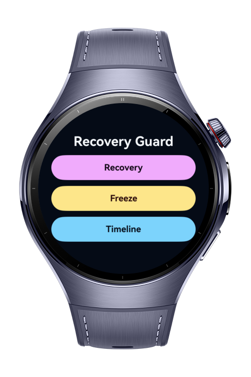
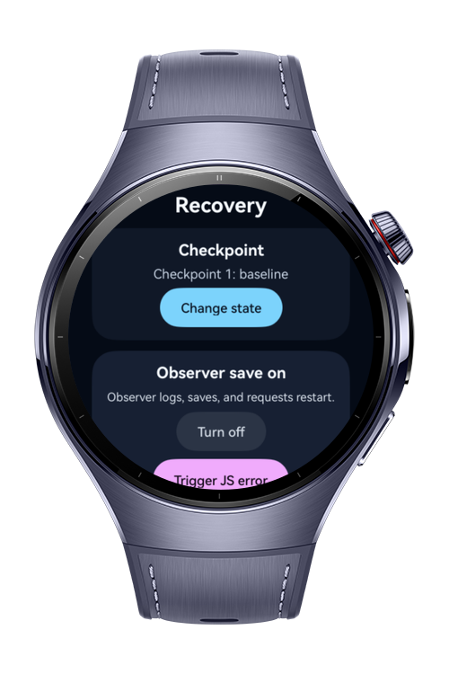
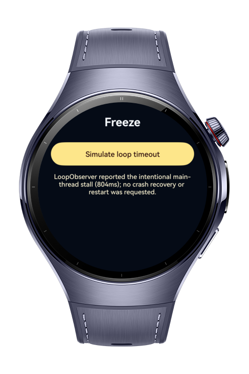
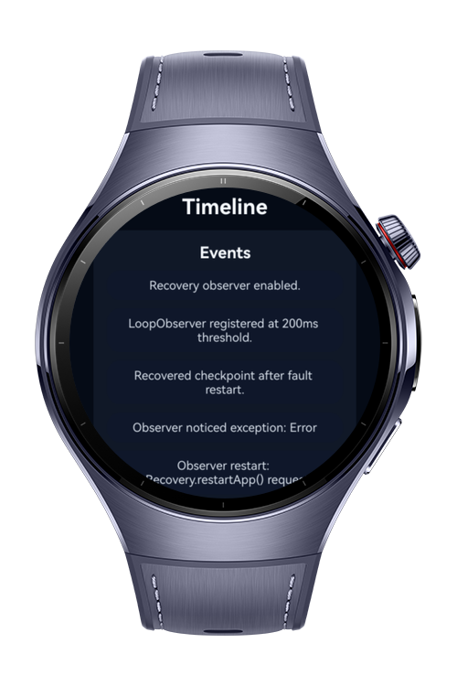

> **Note:** To access all shared projects, get information about environment setup, and view other guides, please visit [Explore-In-HMOS Index](https://github.com/Explore-In-HMOS/hmos-index).

# How to Build Crash Recovery Guard

How to Build Crash Recovery Guard is a HarmonyOS NEXT wearable codelab that demonstrates fault-aware recovery with
appRecovery, ErrorObserver, LoopObserver, recoverable UIAbility state, and a compact incident timeline on a round watch
screen.

# Preview

<div>




</div>

# Use Cases

- Restore a small checkpoint after a recoverable app fault restart.
- Demonstrate AbilityStage recovery setup and the required recoverable UIAbility flag.
- Observe unhandled JS exceptions with ErrorObserver and request a guarded restart path.
- Keep crash observer behavior separate from platform appRecovery behavior.
- Detect a bounded main-thread stall with LoopObserver without treating it as crash recovery.
- Review launch, save, observer, restart, and timeout events from a watch-friendly timeline.

# Tech Stack

Languages: ArkTS
Frameworks: HarmonyOS SDK 6.0.1(21)
Tools: DevEco Studio / hvigor build flow
Libraries/Kits: `@kit.ArkUI`, `@kit.AbilityKit`, `@kit.ArkData`, `@kit.BasicServicesKit`, `@kit.PerformanceAnalysisKit`,
`@ohos.hypium`

# Directory Structure

```
entry/src/main/ets/
|---abilitystage
|---|---AppAbilityStage.ets
|---entryability
|---|---EntryAbility.ets
|---entrybackupability
|---|---EntryBackupAbility.ets
|---models
|---|---IncidentEvent.ets
|---|---LaunchRecoveryState.ets
|---|---RecoveryCheckpoint.ets
|---pages
|---|---Index.ets
|---|---guide
|---|---|---AppNavigator.ets
|---|---|---CrashRecoveryPage.ets
|---|---|---FreezeGuardPage.ets
|---|---|---GuideHomePage.ets
|---|---|---PageRoutes.ets
|---|---|---RouteBuilders.ets
|---|---|---TimelinePage.ets
|---services
|---|---IncidentTimelineStore.ets
|---|---RecoveryGuardService.ets
```

# Constraints and Restrictions

## Supported Devices

- Huawei Watch 5

# LICENSE

How to Build Crash Recovery Guard is distributed under the terms of the MIT License.
See the [LICENSE](/LICENSE) for more information.
